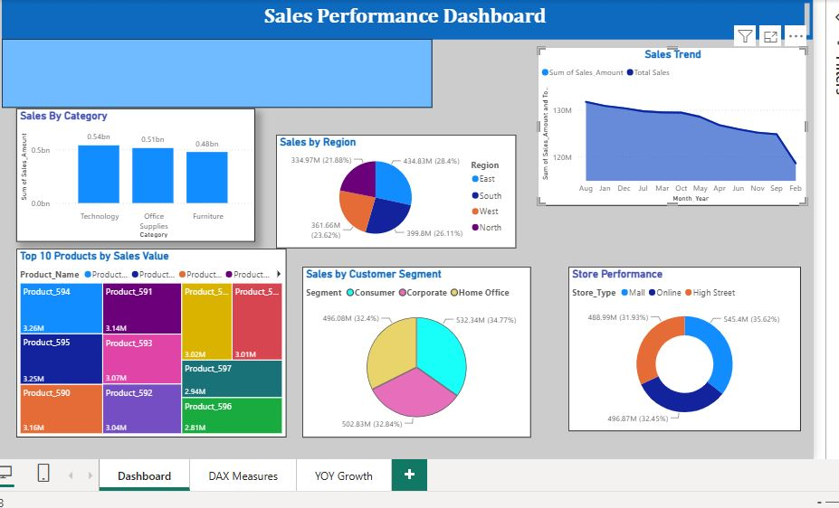

# 📊 Power BI Sales Dashboard

## 📌 Project Overview
This project presents an interactive Sales Dashboard developed using Microsoft Power BI to analyze sales performance and generate meaningful business insights.

The dashboard helps understand sales trends, product performance, and overall business performance through interactive visualizations.

## 🎯 Project Objectives
- Analyze overall sales performance.
- Identify top-performing products.
- Compare sales across different categories.
- Understand gender-wise sales distribution.
- Identify trends and patterns in sales data.
- Support data-driven business decisions.

## 🛠️ Tools & Technologies
- Microsoft Power BI
- Power Query
- DAX
- Data Visualization
- Data Cleaning and Transformation

## 📈 Dashboard Features
- Sales performance overview
- Product-wise sales analysis
- Gender-wise sales analysis
- Interactive charts and visualizations
- Key performance indicators (KPIs)

## 💡 Key Business Insights
This dashboard helps identify:
- Products contributing the highest sales.
- Differences in purchasing patterns by gender.
- Sales trends across product categories.
- Opportunities to improve sales performance.

## 📂 Project Files
- `Power BI Sales Dashboard.pbix` – Interactive Power BI report.
- `images/` – Dashboard screenshots.

## 👩‍💻 Author
**Arati Joshi**

Aspiring Data Analyst | Python | SQL | Excel | Power BI
